<p align="center">
  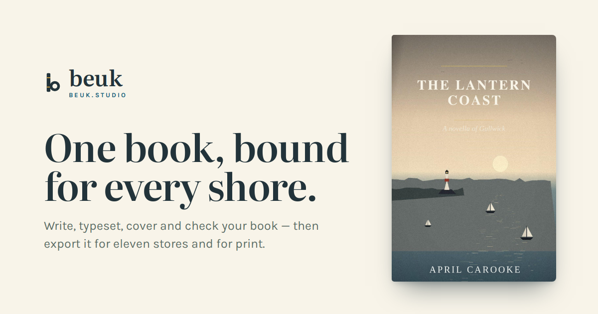
</p>

<h1 align="center">Beuk</h1>
<p align="center"><strong>Your EPUB &amp; print studio, in the browser.</strong><br>
Write, typeset, and ship store-ready books — EPUB for the stores, PDF/X-1a for the printers — from one quiet studio at <a href="https://beuk.studio">beuk.studio</a>.</p>

---

## What it does

Beuk is a browser-based book studio. You write on a plain page; Beuk typesets the real book beside you — live, on real e-reader profiles and real print trim sizes — and exports files the stores actually accept:

- **EPUB 3** with real validation: server-side **EPUBCheck** runs against your actual file, and every finding maps to a plain-language fix.
- **Print interiors as PDF/X-1a:2001** — converted on the server through a real press profile, with facing pages, running heads, footnotes set at the page foot, and bleed done the way KDP and IngramSpark ask for it.
- **Store-ready? reports** for Amazon KDP and IngramSpark: trim, page count, margins, spine, ink coverage, font embedding — every row pass/fail with the store's own rule cited and a one-click fix where Beuk can make it.
- **Word, Markdown, standalone HTML, ACX audio scripts, and Shunn-format submission manuscripts**, all built from the same book.

Your words are **local-first**: every book saves on your device as you type, signed in or not, online or not. An account adds a synced shelf, an export archive, and beta-reader links.

## The studio

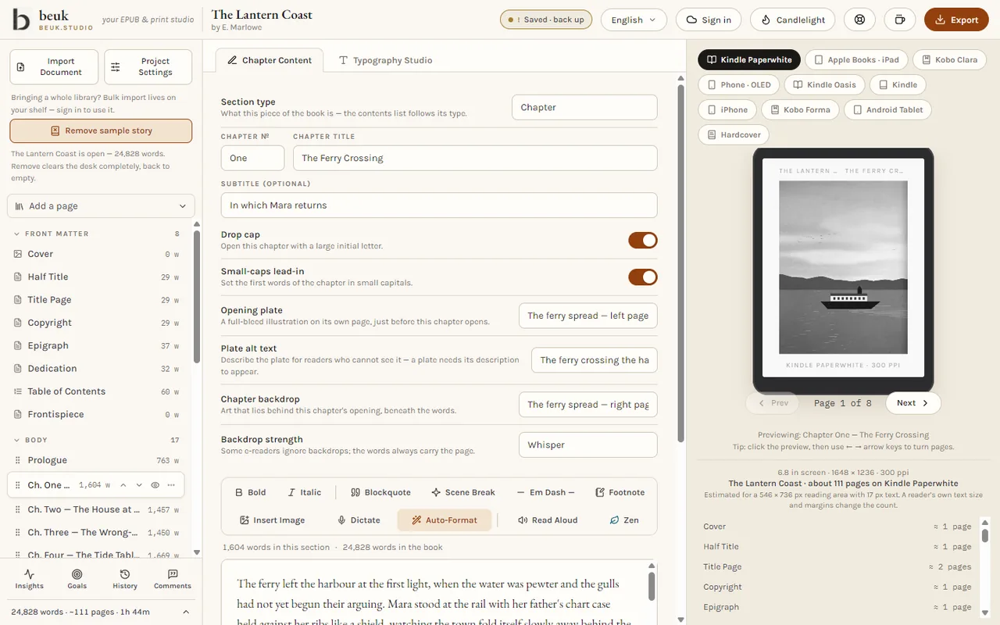

Write in plain text with light marks; the preview page-turns the typeset result on Kindle, Kobo, iPad and phone profiles — line breaks and page breaks as the device would set them, with a measured page count per device.

<table>
  <tr>
    <td>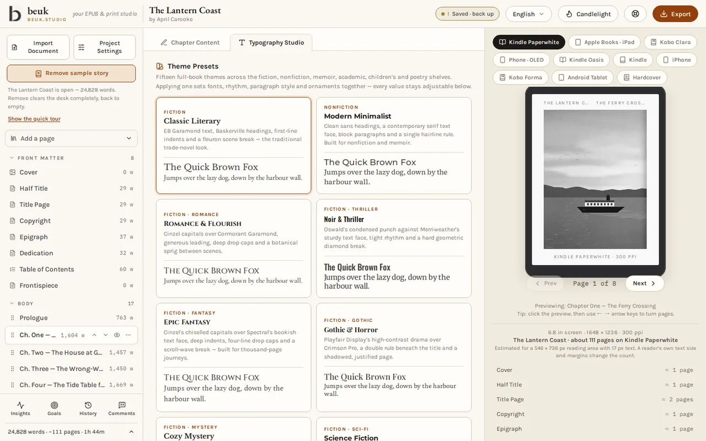</td>
    <td>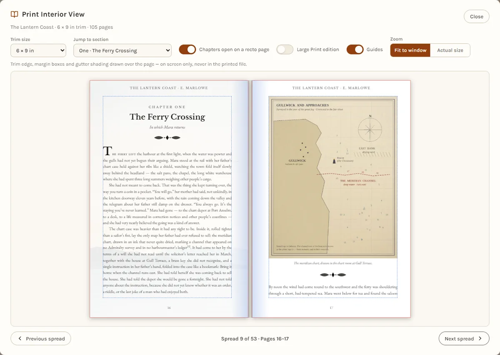</td>
  </tr>
  <tr>
    <td align="center"><sub><strong>Typography Studio</strong> — twenty self-hosted book faces, display faces for headings, drop caps, ornaments, a one-colour accent with contrast checked before it's accepted.</sub></td>
    <td align="center"><sub><strong>Print Interior View</strong> — the real paginated book at trim size: facing pages, painted spreads, footnotes at the page foot, bleed.</sub></td>
  </tr>
  <tr>
    <td>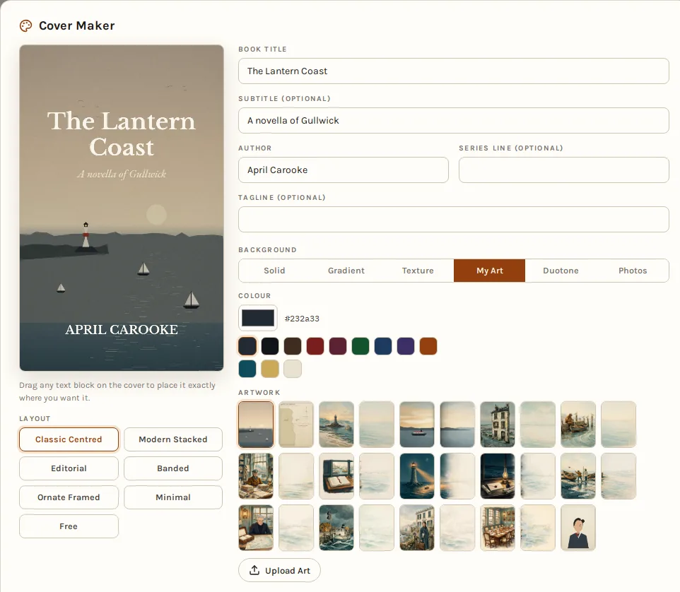</td>
    <td>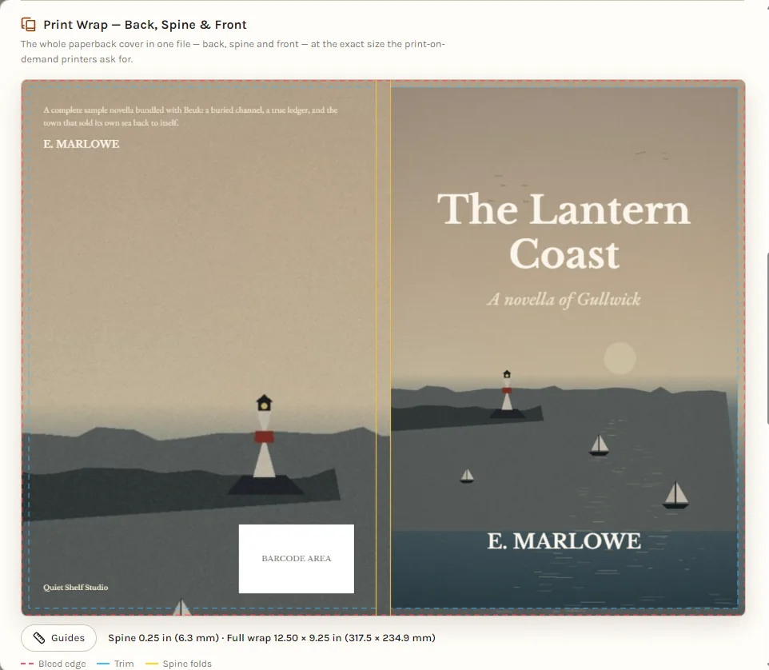</td>
  </tr>
  <tr>
    <td align="center"><sub><strong>Cover maker</strong> — layouts, stock photo search, your own art.</sub></td>
    <td align="center"><sub><strong>Print wrap</strong> — front, spine and back, spine width computed from the store's own factor.</sub></td>
  </tr>
  <tr>
    <td>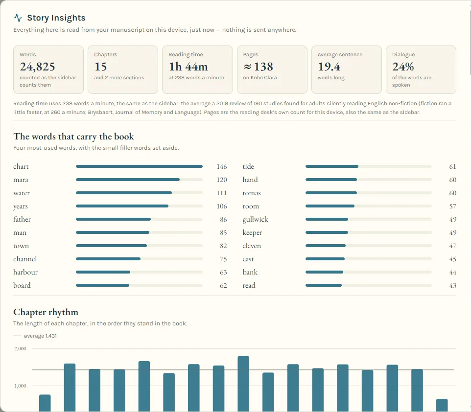</td>
    <td>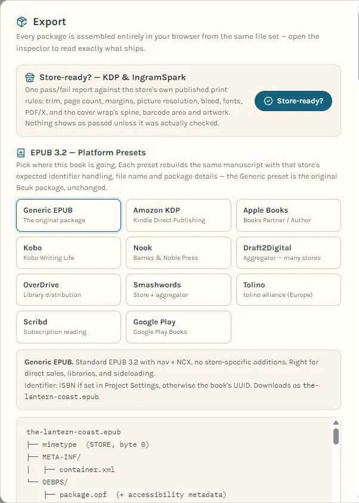</td>
  </tr>
  <tr>
    <td align="center"><sub><strong>Story Insights</strong> — rhythm, cadence, dialogue share, crutch words, echoes, a heatmap of the names your book keeps returning to. Computed on your device, never guessed.</sub></td>
    <td align="center"><sub><strong>Export</strong> — store presets for EPUB, print, Word, Markdown, ACX, and the Store-ready? pass/fail report.</sub></td>
  </tr>
</table>

## Books printed by Beuk, open on the table

Every spread below is a real page pair from a book typeset in the studio and printed by Beuk's own renderer — no mockups.

<table>
  <tr>
    <td>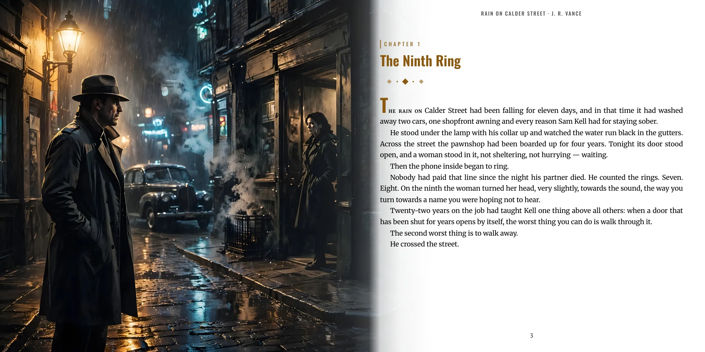</td>
    <td>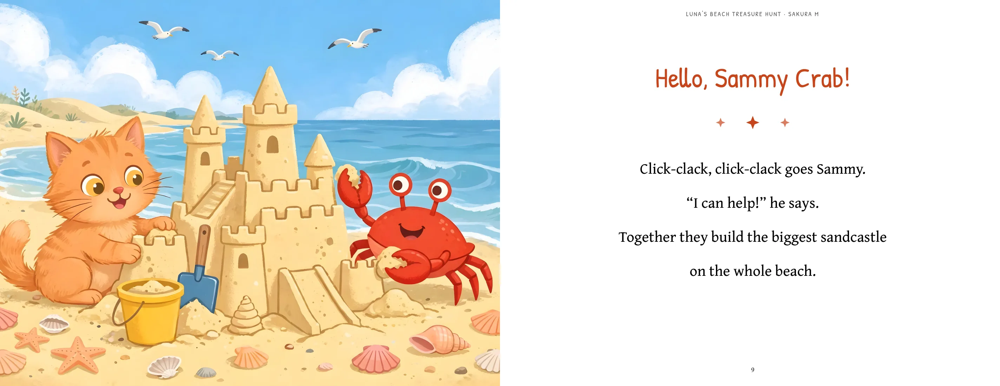</td>
  </tr>
  <tr>
    <td>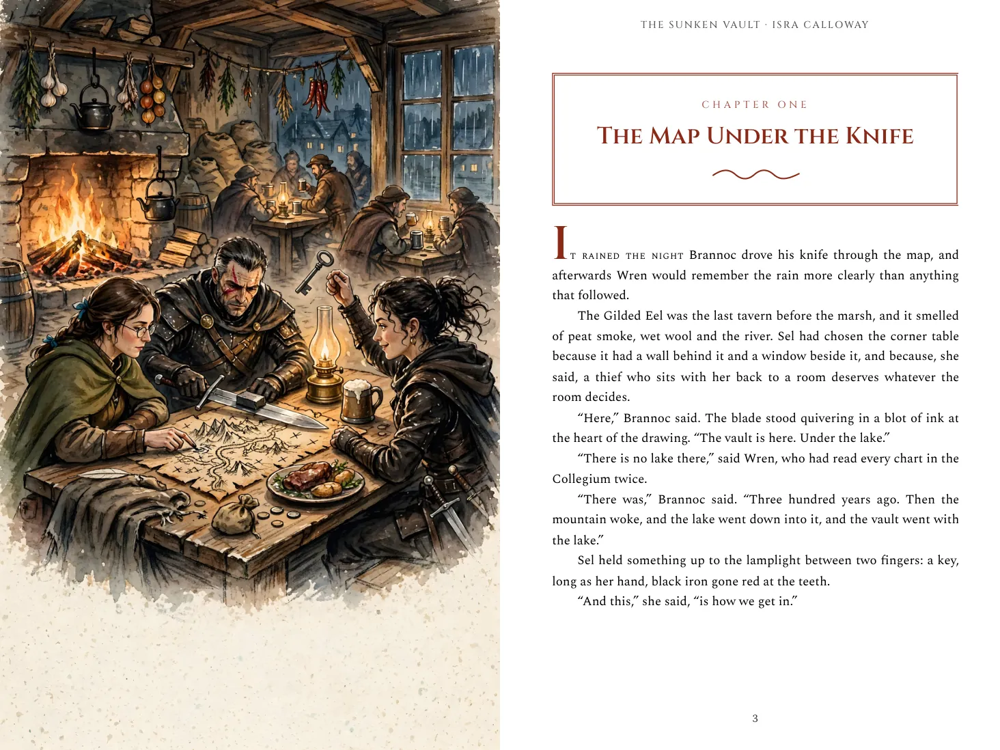</td>
    <td></td>
  </tr>
</table>

Turn through whole books in the full-screen reader at **[beuk.studio/ramp](https://beuk.studio/ramp)**, and walk around the 3D editions in the **[Bowmarket](https://beuk.studio/school/bowmarket)** — drag a book and it turns all the way round.

## Use Beuk from Claude

Beuk ships as a Claude plugin: connect your shelf and Claude can read your manuscripts, edit chapters, build the store-ready EPUB, run EPUBCheck, and report **Beuk's own writing analytics** — cast, cadence, crutch words, dialogue share, readability, echoes — computed server-side by Beuk, never estimated.

```
claude plugin marketplace add viklahan/beuk
claude plugin install beuk@beuk
```

Sign in once with your Beuk account when prompted; everything Claude touches is scoped to your own shelf.

## Beta readers, built in

<table>
  <tr>
    <td>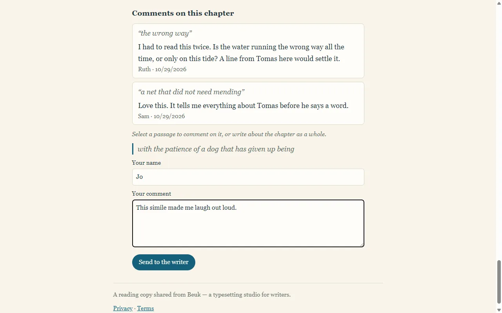</td>
    <td>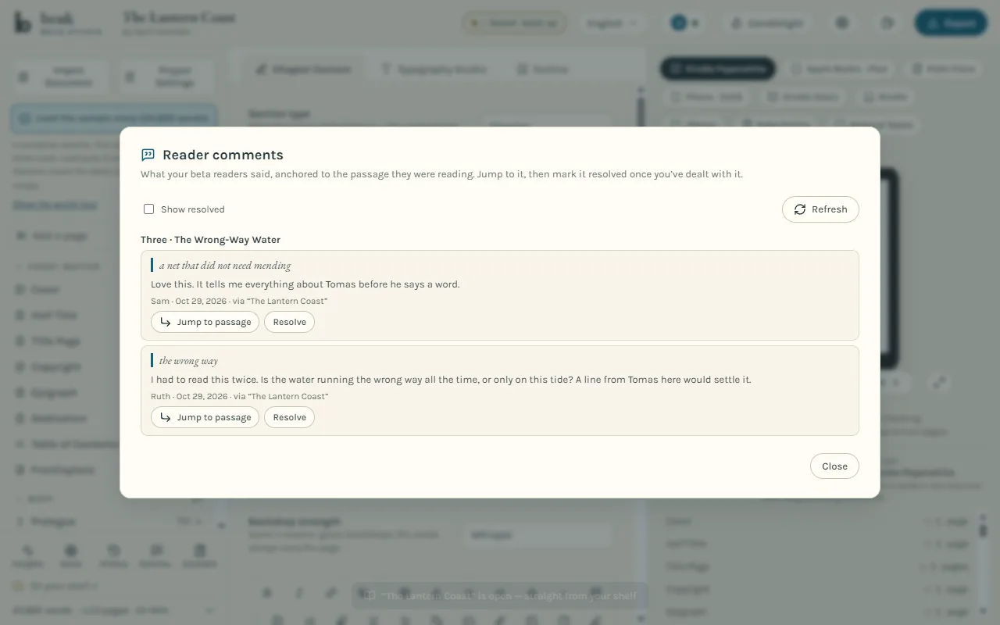</td>
  </tr>
</table>

Share a frozen, read-only copy by link; readers comment without an account, and every comment lands back in your studio anchored to the passage it quotes.

## More than a typesetter

- **Covenant** — the people, places and things of your book (and your series), kept with the book, found in the text on your device. AI-free.
- **Goals, streaks and History** — writing days, a daily target computed from your deadline, word-by-word compare against any snapshot. The streak forgives rest days by design.
- **Imports that show their work** — Word, Markdown, plain text and PDF, each followed by a "Here's what we changed" report with per-item undo.
- **13 studio languages, 36 book languages**, right-to-left books included, with real Arabic and Devanagari book faces embedded.
- **Offline-complete** — the studio installs as an app and keeps working without a network.

## Pricing

21 days free with an account, then one price for everything. Your own words stay downloadable — the backup file, Word and Markdown exports never lock, trial or no trial.

## School

Free courses, a weekly broadsheet, and the Bowmarket bookshop live at **[beuk.studio/school](https://beuk.studio/school)**.

---

## For engineers

The full engineering reference — stack, API, jobs pipeline, renderer sandbox, billing plumbing, backup/restore evidence, the simulation harness — lives in **[docs/ENGINEERING.md](docs/ENGINEERING.md)**.

<sub>Beuk is a product of its maker, not an open-source project; the source is published for transparency, not for reuse. © Beuk. All rights reserved.</sub>
